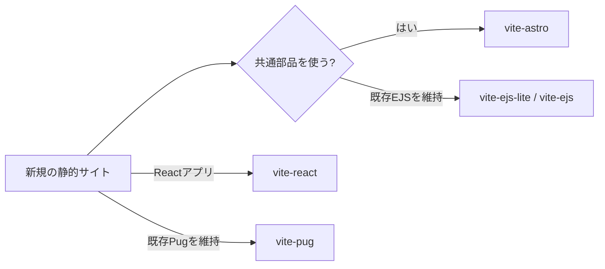

# Web Template

Vite 8またはAstro 7対応のスターターキット集です。作りたいサイトに合うものを1つ選んでください。

現在のバージョンは`1.5.0`です。変更内容は[Changelog](./CHANGELOG.md)を参照してください。

| 作りたいもの | 選ぶテンプレート |
| --- | --- |
| Reactサイト | [Vite + React + Sass](./vite-react) |
| 部品を分割する新規静的サイト | [Astro + Sass](./vite-astro) |
| シンプルなEJSサイト | [Vite + EJS + Sass Lite](./vite-ejs-lite) |
| 画像最適化を含むEJSサイト | [Vite + EJS + Sass](./vite-ejs) |
| 既存Pug案件 | [Vite + Pug + Sass](./vite-pug) |

## 開始手順

選んだテンプレートのディレクトリで実行します。

```sh
pnpm install
pnpm dev
```

開発サーバーは <http://localhost:5173> で確認できます。



## 共通コマンド

| コマンド | 用途 |
| --- | --- |
| `pnpm dev` | 開発サーバーを起動する |
| `pnpm build` | `dist`へ公開用ファイルを生成する |
| `pnpm preview` | ビルド結果を確認する |
| `pnpm test` | テンプレートの要件を確認する |

## 開発方針

要件、開発順序、完了条件は[要件定義](./REQUIREMENTS.md)を参照してください。エージェントは[Agent Instructions](./AGENTS.md)に従います。
