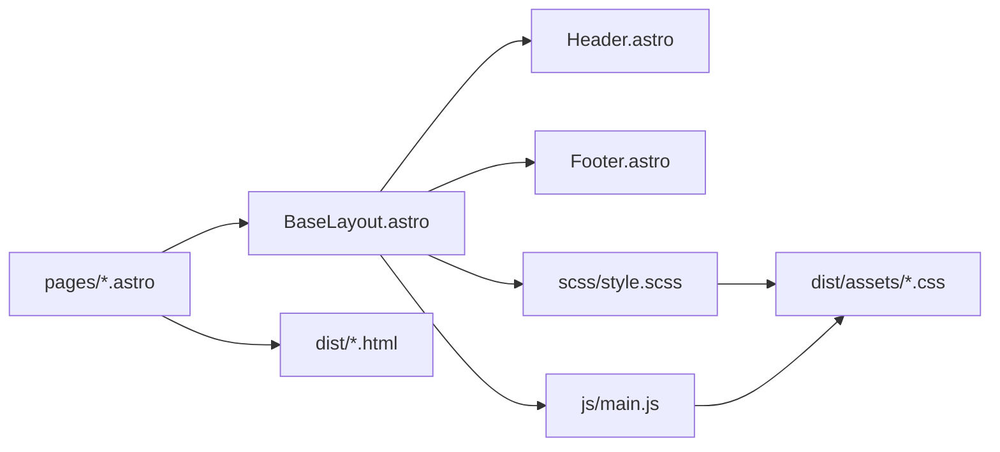

# Astro + Sass Template

Astro、JavaScript、Sassで小規模な静的サイトを作るテンプレートです。EJSを使わず、HeaderやFooterを部品として読み込めます。

## 必要な環境

- Node.js `>=22.23.4`
- pnpm `10.32.1`

## 開始

```sh
pnpm install
pnpm dev
```

<http://localhost:5173> を開きます。



## コマンド

| コマンド | 結果 |
| --- | --- |
| `pnpm dev` | 開発サーバーを起動する |
| `pnpm build` | 公開用の静的HTMLを`dist`へ生成する |
| `pnpm preview` | <http://localhost:8080> でビルド結果を確認する |
| `pnpm test` | Astroテンプレートの要件を検査する |

## 最初に編集する場所

1. `src/components/Header.astro`でナビゲーションを編集する。
2. `src/pages`でページを追加・編集する。
3. `src/scss/style.scss`で共通スタイルを編集する。
4. `src/js/main.js`で共通JavaScriptを編集する。

SCSSとJavaScriptの初期構成は`vite-ejs-lite`から継承しています。ビルド後はCSSを`dist/assets/css/style.css`、JavaScriptを`dist/assets/js/main.js`へ出力します。

画像、PDF、フォントは`src/assets`からページまたはSCSSへimportします。importされたファイルだけが種類別に出力され、HTMLとCSSの参照先も自動変換されます。

```text
dist/
├── assets/
│   ├── css/style.css
│   ├── fonts/blank.woff2
│   ├── images/sample.png
│   ├── js/main.js
│   └── pdf/sample.pdf
├── about/index.html
├── index.html
└── news/index.html
```

`build.format: 'preserve'`により、`src/pages`の配置を保ってHTMLを生成します。`about/index.astro`は`about/index.html`、`company/message.astro`は`company/message.html`になります。

`directory`、`file`、`preserve`の比較とページ配置例は[HTML出力形式](./docs/build-formats.md)を参照してください。

```text
src/pages/company/
├── index.astro       → dist/company/index.html
└── message.astro     → dist/company/message.html
```

## ディレクトリ構成

```text
vite-astro/
├── docs/
│   └── build-formats.md     # HTML出力形式の比較
├── public/                 # 加工せず公開するファイル
├── src/
│   ├── components/
│   │   ├── Footer.astro    # 共通Footer
│   │   └── Header.astro    # 共通Headerと繰り返し例
│   ├── assets/
│   │   ├── fonts/blank.woff2 # フォント例
│   │   ├── images/sample.png # 画像例
│   │   └── pdf/sample.pdf    # PDF例
│   ├── layouts/
│   │   └── BaseLayout.astro # HTML全体の共通レイアウト
│   ├── js/                  # vite-ejs-lite継承JavaScript
│   ├── pages/
│   │   ├── about/
│   │   │   └── index.astro # Aboutページ
│   │   ├── index.astro     # トップページ
│   │   └── news/
│   │       └── index.astro # Newsページ
│   └── scss/                # vite-ejs-lite継承Sass
│       └── style.scss       # 共通Sassエントリ
├── tests/
│   └── template.test.mjs   # 要件テスト
├── astro.config.mjs        # Astro設定
└── package.json            # コマンドと依存関係
```

## テンプレート内の繰り返し

配列はJavaScriptの`map()`でHTMLへ展開します。

```astro
{items.map((item) => <li>{item.label}</li>)}
```

共通仕様は[要件定義](../REQUIREMENTS.md)を参照してください。
