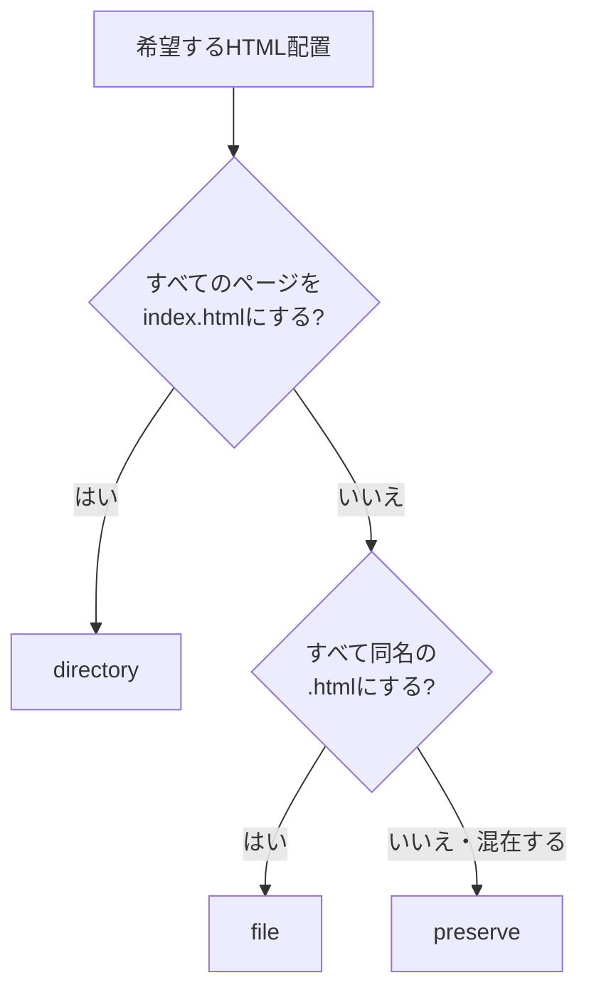

# AstroのHTML出力形式

## 結論

このテンプレートは`preserve`を使います。

```js
// astro.config.mjs
build: {
  format: 'preserve',
  assets: 'assets'
}
```

理由は、次の2種類を同じディレクトリ内で扱えるためです。

```text
src/pages/company/
├── index.astro       → dist/company/index.html
└── message.astro     → dist/company/message.html
```

## どれを選ぶか



| 目的 | 選ぶ形式 |
| --- | --- |
| 全ページを`ページ名/index.html`にする | `directory` |
| 全ページを`ページ名.html`にする | `file` |
| `index.html`と任意名`.html`を配置どおりに混在させる | `preserve` |

## 3形式の違い

同じ入力ファイルを使った場合の違いです。

```text
src/pages/
├── index.astro
└── company/
    ├── index.astro
    └── message.astro
```

| 入力 | `directory` | `file` | `preserve` |
| --- | --- | --- | --- |
| `index.astro` | `index.html` | `index.html` | `index.html` |
| `company/index.astro` | `company/index.html` | `company.html` | `company/index.html` |
| `company/message.astro` | `company/message/index.html` | `company/message.html` | `company/message.html` |

## URLの違い

| 形式 | 会社トップ | メッセージ |
| --- | --- | --- |
| `directory` | `/company/` | `/company/message/` |
| `file` | `/company.html` | `/company/message.html` |
| `preserve` | `/company/` | `/company/message.html` |

`preserve`を使う場合のリンク例です。

```astro
<a href="/company/">会社情報</a>
<a href="/company/message.html">代表メッセージ</a>
```

## 各設定例

### directory

```js
build: {
  format: 'directory'
}
```

すべてのページをディレクトリと`index.html`の組み合わせで公開するときに使います。

### file

```js
build: {
  format: 'file'
}
```

すべてのページを`.html`付きURLで公開するときに使います。`company/index.astro`も`company.html`になる点に注意してください。

### preserve

```js
build: {
  format: 'preserve'
}
```

`src/pages`のファイル配置をHTML出力へ反映します。ディレクトリトップには`index.astro`、下層の単独HTMLには`message.astro`のような名前を使います。

## ページを追加する手順

`company/index.html`と`company/message.html`を追加する例です。

1. `src/pages/company`を作る。
2. `src/pages/company/index.astro`を作る。
3. `src/pages/company/message.astro`を作る。
4. ナビゲーションを`/company/`または`/company/message.html`へ向ける。
5. `pnpm build`を実行する。
6. `dist/company/index.html`と`dist/company/message.html`を確認する。

## 変更時の確認

- `astro.config.mjs`の`build.format`とこの資料が一致している。
- `src/pages`の配置とREADMEのディレクトリツリーが一致している。
- Headerなどのリンクが生成後のURLを参照している。
- `pnpm test`が成功する。
- `pnpm build`後の`dist`が期待する配置になっている。
